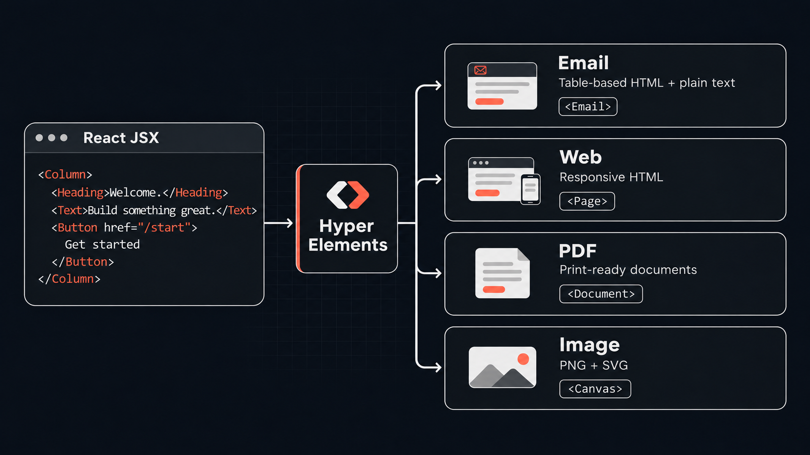
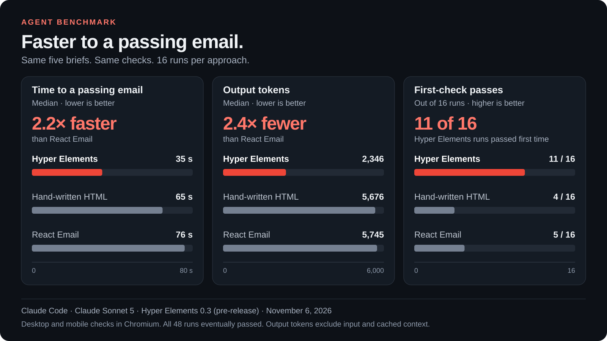

<p align="center">
  
</p>

<h1 align="center">Hyper Elements</h1>

<p align="center">
  <strong>The content engine for agents.</strong><br />
  React in. Emails, web pages, PDFs, and images out.
</p>

<p align="center">
  <a href="https://hyperelements.dev/docs">Documentation</a> ·
  <a href="https://hyperelements.dev/components">Components</a> ·
  <a href="https://hyperelements.dev/templates">Templates</a> ·
  <a href="#quick-start">Quick start</a>
</p>

<p align="center">
  <a href="https://github.com/hyper-elements/hyper-elements/actions/workflows/test.yml"></a>
  <a href="./LICENSE"></a>
</p>

Hyper Elements is an open-source React library for building content in code. You or your coding agent write typed components; the engine handles layout, checks what each output supports, and renders the result on your server.

An agent can validate its template, read a compact layout outline, and use structured diagnostics to fix mistakes before rendering.

<p align="center">
  
</p>

## One component system. Four outputs.

Share content, layout components, and styles across formats. Choose a root for the destination; Hyper Elements writes the output that destination needs.

| Build | Root | Output |
| --- | --- | --- |
| Receipts, campaigns, and transactional emails | `<Email>` | Table-based HTML and plain text |
| Landing pages and web versions of your content | `<Page>` | Responsive HTML with no client-side JavaScript required |
| Invoices, reports, and documents | `<Document>` | Print-ready HTML or a PDF |
| Social cards, Open Graph images, and banners | `<Canvas>` | PNG or SVG |

`render()` writes HTML. [`renderPdf()`](./packages/react/docs/render-pdf.md) and [`renderImage()`](./packages/react/docs/render-image.md) write files in Node.js without a browser, using optional rendering dependencies. Diagnostics explain when a component or style cannot carry over to a particular output.

## Built for the agent loop

**Write → validate → inspect → fix → render.**

- **A guide that matches the installed version.** `GUIDE.md` and `REFERENCE.md` ship with the package and are generated from the component definitions.
- **Errors an agent can act on.** `validate()` returns a diagnostic code, severity, template path, and a message explaining the problem and what to use instead.
- **Layout as text.** `outline()` shows each block's width, content, and responsive stacking so an agent can inspect a layout without reading generated HTML.
- **One consistent API.** Typed props, styles in `style={{ … }}`, spacing with `gap`, and reusable React components.
- **Predictable output.** Rendering is deterministic, runs in your process, and needs no account or API key.

### Give your agent the guide

Install the repository's agent skill:

```bash
npx skills add hyper-elements/hyper-elements
```

Or add this instruction to your project's `AGENTS.md` or coding-agent rules:

```text
Before writing a Hyper Elements template, read
node_modules/@hyper-elements/react/GUIDE.md.
Run validate(), resolve errors, review warnings, and inspect outline() before rendering.
```

The docs are also available as [llms.txt](https://hyperelements.dev/llms.txt) and [llms-full.txt](https://hyperelements.dev/llms-full.txt). See the [agent guide](https://hyperelements.dev/docs/guides/ai-agents) for setup and examples.

## Faster to a passing email

In our agent benchmark, Hyper Elements reached a passing email **2.2× faster than React Email** and **1.9× faster than hand-written HTML**, at the median. It also needed fewer output tokens and passed the checks on the first attempt more often.

<p align="center">
  <a href="https://hyperelements.dev/docs/benchmark">
    
  </a>
</p>

Five email briefs, the same Chromium checks at desktop and mobile widths, and 16 runs per approach. Measured with Claude Code and Claude Sonnet 5 on November 6, 2026, using Hyper Elements 0.3 before release. All 48 runs eventually passed. Token figures measure output tokens; they do not imply lower total token usage or cost.

[Results and methodology](https://hyperelements.dev/docs/benchmark) · [Harness, briefs, and raw results](./apps/website/benchmark)

## Quick start

Install with React 18 or later:

```bash
npm install @hyper-elements/react react react-dom
```

Write a template and render it:

```tsx
import {
  Button, Column, Email, Heading, Text, render,
} from "@hyper-elements/react";

function Welcome({ name }: { name: string }) {
  return (
    <Email
      width={600}
      previewText="Your next idea starts here."
      style={{ backgroundColor: "#f4f4f5", fontFamily: "Arial, sans-serif" }}
    >
      <Column style={{ backgroundColor: "#ffffff", padding: 32, gap: 16 }}>
        <Heading level={1} style={{ fontSize: 28 }}>
          Welcome, {name}.
        </Heading>
        <Text>Build something great.</Text>
        <Button
          href="https://example.com/start"
          style={{ backgroundColor: "#ef4638", color: "#ffffff" }}
        >
          Get started
        </Button>
      </Column>
    </Email>
  );
}

const { html, text, diagnostics } = await render(<Welcome name="Ada" />);
```

`html` is a complete email document; `text` is its plain-text counterpart. Pass them to your email provider. `diagnostics` contains warnings and notes; invalid templates reject with an `ElementsError`. [Sending email →](https://hyperelements.dev/docs/guides/sending)

To check the same component before rendering:

```tsx
import { outline, validate } from "@hyper-elements/react";

const template = <Welcome name="Ada" />;
const report = validate(template);

for (const { code, path, message } of report.diagnostics) {
  console.log(code, path, message);
}

if (report.valid) {
  console.log(outline(template));
}
```

`valid` means there are no errors; review warnings too. For example, a diagnostic can tell you that classic Outlook will show square corners, or that content is wider than its container. These checks use the engine's support rules; they do not open your template in every email client. [Diagnostics →](https://hyperelements.dev/docs/diagnostics)

## Explore

| Start with | For |
| --- | --- |
| [Templates](https://hyperelements.dev/templates) | Ready-to-use emails, pages, documents, and images |
| [Components](https://hyperelements.dev/components) · [API reference](./packages/react/REFERENCE.md) | Layout, typography, tables, images, and custom components |
| [One invoice, multiple outputs](./examples/content-workflows) | A runnable email, web, and PDF workflow with email-provider integrations |
| [Next.js example](./examples/nextjs-app-router) | Rendering in Server Components and route handlers |
| [PDF output](./packages/react/docs/render-pdf.md) · [Image output](./packages/react/docs/render-image.md) | Optional dependencies, fonts, assets, and format limits |
| [Migrate from React Email](./packages/react/docs/migrate-from-react-email.md) · [Upgrade from Elements 0.2](./packages/react/docs/migrating-from-0.2.md) | Convert existing templates and check the results |
| [Visual editing](./packages/react/docs/visual-editing.md) | Hand code-authored templates to the Unlayer editor and read edits back |

Hyper Elements works independently of the Unlayer platform. The visual-editor integration is optional.

## Contributing

Use the Node.js version in [`.nvmrc`](./.nvmrc) and pnpm 9.7 or later.

```bash
pnpm install
pnpm build
pnpm test
```

The engine lives in [`packages/core`](./packages/core), the React API in [`packages/react`](./packages/react), migration tools in [`packages/migrate`](./packages/migrate), and the website in [`apps/website`](./apps/website). See the [contributing guide](./CONTRIBUTING.md) for the development workflow.

## License

[MIT](./LICENSE) — built by the team behind [Unlayer](https://unlayer.com).
